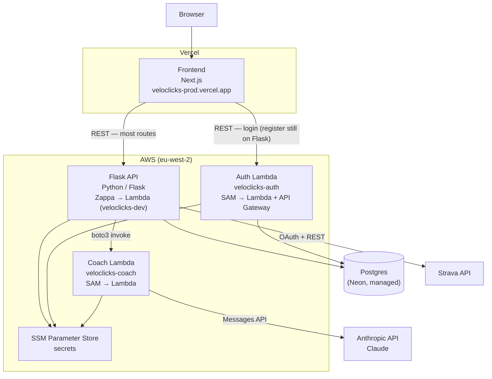
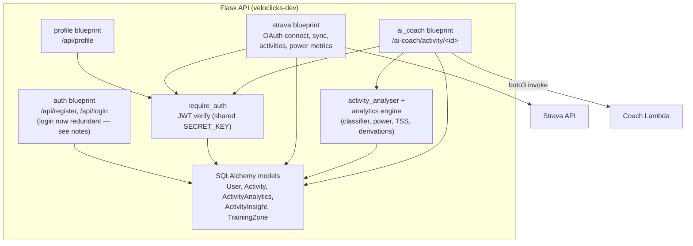
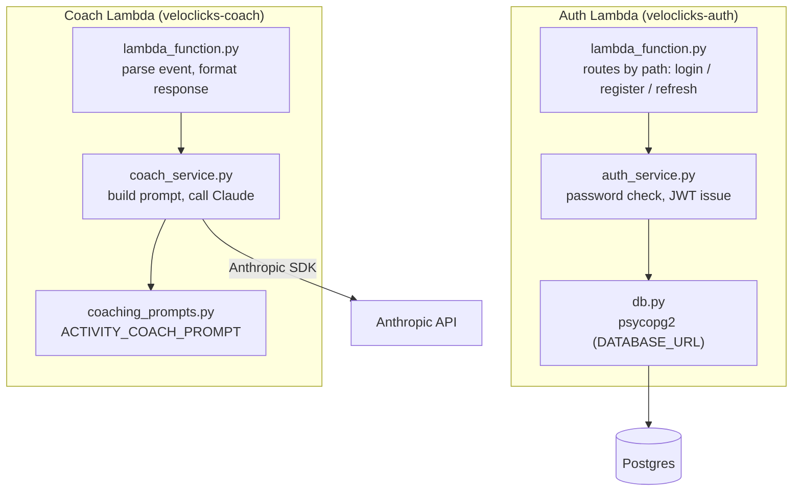
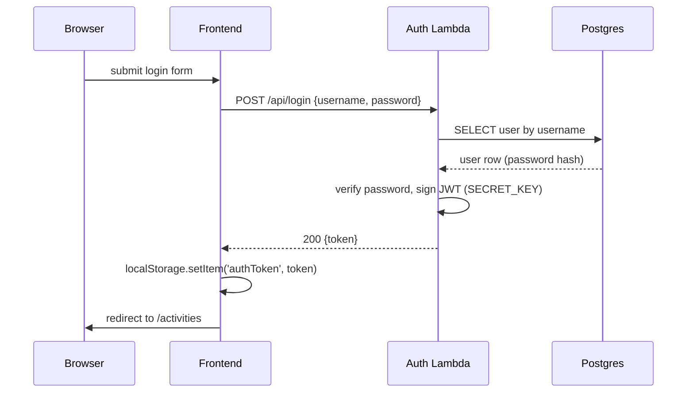
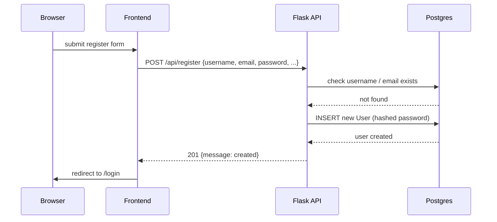
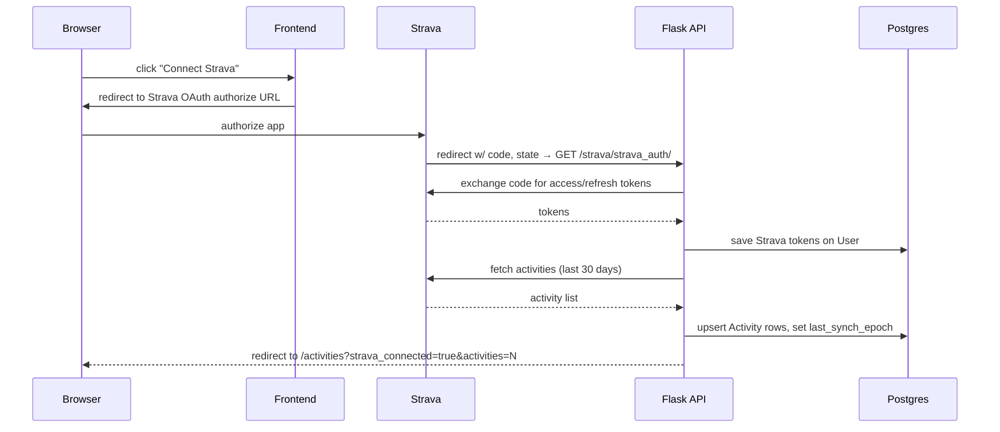
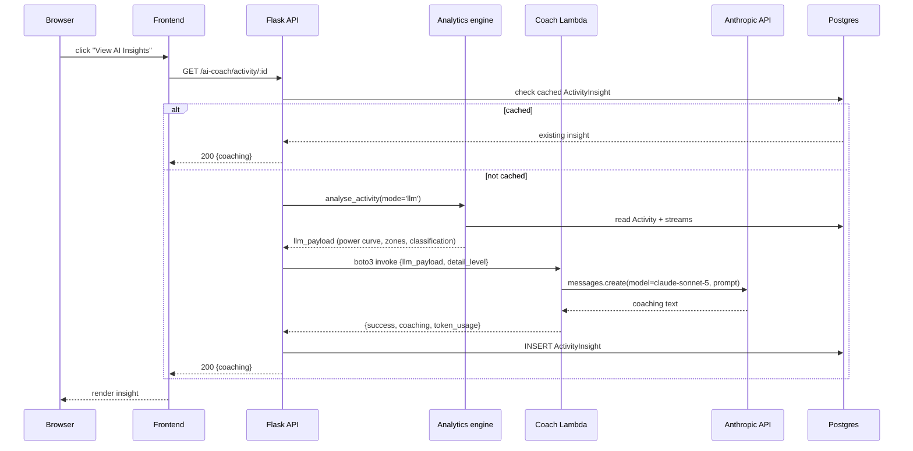

# Application Architecture

Snapshot as of 2026-08-28. Reflects what's actually deployed, not aspirational config —
see notes under each diagram for known gaps between the two.

## Container diagram (C4, level 2)

**Notes**
- Auth and Coach are deployed together under one CloudFormation stack (`veloclicks-lambdas`, from `aws/lambdas/template.yaml`). Flask is deployed separately via Zappa, unrelated tooling.
- Only the frontend's **login** call was cut over to the Auth Lambda. **Register** still goes through Flask, even though the Auth Lambda also implements `/api/register` — see the Register sequence below.
- There is no "production" AWS environment — only `dev` exists (see [claude.md](../claude.md)). The Vercel frontend and Postgres DB are the only genuinely production-facing pieces today.

## Component diagram (C4, level 3)

### Flask API

### Auth Lambda & Coach Lambda

**Notes**
- Auth Lambda runs locally via `sam local start-api` (real API Gateway event simulation, maintained by AWS) rather than Docker Compose — see [docs/cheat_sheet.md](cheat_sheet.md). Coach Lambda still runs under Docker Compose, using the Lambda base image's own Runtime Interface Emulator directly — a faithful simulation of the `boto3.invoke()` path Flask actually uses, so no separate tooling is needed there.
- Coach Lambda has no DB access — it's a pure prompt-in/text-out function; the analytics data is assembled entirely by Flask before invocation.

## Endpoint Inventory

All routes require `Authorization: Bearer <token>` unless noted otherwise. "Entry point" is the file containing the route/handler function itself.

### Flask — Admin (`flask/app/admin/`, no `url_prefix`, no auth)

| Method & Path | Description | Inputs | Outputs | Entry point |
|---|---|---|---|---|
| GET `/` | Health check for the load balancer (kept at root deliberately) | — | `"OK"`, 200 | `admin/routes.py` |
| GET `/health` | Health check | — | `{"status": "ok"}`, 200 | `admin/routes.py` |
| GET `/db_tools` | Debug: checks date-parsing sanity on 5 sample activities (results only printed to logs) | — | `{"status": "ok"}`, 200 | `admin/routes.py` |
| GET `/listusers` | Lists all users | — | JSON array of user string reprs | `admin/routes.py` |

### Flask — Auth (`flask/app/auth/`, prefix `/api`, no auth)

Mid-migration: these are being superseded by the Auth Lambda below. The frontend already calls the Lambda directly for login; both these Flask routes are still live and unretired.

| Method & Path | Description | Inputs | Outputs | Entry point |
|---|---|---|---|---|
| POST `/api/register` | Create a user account | JSON: `username`, `email`, `firstname`, `lastname`, `password` | `{"message"}`, 201 / 400 | `auth/routes.py` |
| POST `/api/login` | Authenticate, issue JWT | JSON: `username`, `password` | `{"token"}`, 200 / `{"message"}`, 401 | `auth/routes.py` |

### Flask — Profile (`flask/app/profile/`, prefix `/api`)

| Method & Path | Description | Inputs | Outputs | Entry point |
|---|---|---|---|---|
| GET `/api/profile` | Fetch the user's profile (FTP, HR, zones, Strava tokens, etc.) | Bearer token | Profile JSON, 200 / `{"message"}`, 404 | `profile/routes.py` |
| PUT `/api/profile` | Update the user's profile | Bearer token, JSON body | `{"message"}`, 200 / `{"error"}`, 400 | `profile/routes.py` |

### Flask — Strava (`flask/app/strava/`, prefix `/strava`)

| Method & Path | Description | Inputs | Outputs | Entry point |
|---|---|---|---|---|
| GET/POST `/strava/strava_auth/` | Strava OAuth callback (no Bearer token — runs before one can exist) | Query: `code`, `state`, `error` | Redirect to frontend | `strava/routes.py` |
| GET `/strava/synch/` | Incremental sync since last sync | Bearer token | `{"success", "new_activities", "total_processed", "message"}` | `strava/routes.py` |
| GET `/strava/activities/` | List stored activities | Bearer token, query `years` (optional, comma-separated) | JSON array of activities | `strava/routes.py` |
| GET `/strava/strava/all_activities/` | Bulk historical sync, hardcoded 2022–2024 window. **Path is doubled** — the route is declared as `/strava/all_activities/` on a blueprint already prefixed `/strava`, so the live path is `/strava/strava/all_activities/`, likely unintentional. | Bearer token | Sync result JSON | `strava/routes.py` |
| GET `/strava/activity/<id>` | Get one activity, including `power_curve_data`/`time_in_zones` if analytics exist | Bearer token, path `id` | Activity JSON, 200 / 404 | `strava/routes.py` |
| GET `/strava/activity/<id>/streams` | Raw stream data (e.g. lat/lng) | Bearer token, path `id`, query `types` | Streams JSON, 200 / 404 | `strava/routes.py` |
| GET `/strava/activity/<id>/elevation-profile` | Optimized elevation profile | Bearer token, path `id` | Profile JSON, 200 / 404 | `strava/routes.py` |
| PUT `/strava/activity/<id>/rpe` | Set RPE (1–10) for one activity | Bearer token, path `id`, JSON `{rpe}` | `{"message", "activity_id", "rpe"}`, 200 / 400 / 404 | `strava/routes.py` |
| PUT `/strava/activities/rpe` | Bulk RPE update | Bearer token, JSON `{updates: [...]}` | `{"message", "count"}`, 200 / 400 | `strava/routes.py` |
| POST `/strava/activity/<id>/calculate-power-metrics` | Compute + persist power curve and time-in-zones | Bearer token, path `id` | Calc summary JSON, 200 / 404 / 500 | `strava/routes.py` |
| POST `/strava/activity/<id>/calculate-tss` | Compute TSS (HR-based) | Bearer token, path `id` | `{"message", "activity_id", "tss"}`, 200 / 404 / 500 | `strava/routes.py` |
| GET `/strava/monthly_synch` | Historical sync by year (+ optional month). **Premium only.** | Bearer token, query `year` (required), `month` (optional) | Sync summary JSON, 200 / 400 / 403 / 404 / 500 | `strava/routes.py` |

### Flask — AI Coach (`flask/app/ai_coach/`, prefix `/ai-coach`, Premium only)

| Method & Path | Description | Inputs | Outputs | Entry point |
|---|---|---|---|---|
| GET `/ai-coach/activity/<id>` | Get (or generate + cache, invoking Coach Lambda via `boto3`) AI coaching insight | Bearer token, path `id`, query `detail_level` (optional) | `{"coaching", "token_usage"}`, 200 / error | `ai_coach/routes.py` |
| GET `/ai-coach/activity/<id>/summary` | Returns the JSON payload that would be sent to the coach LLM, without invoking it | Bearer token, path `id` | `{"summary": {...}}`, 200 / error | `ai_coach/routes.py` |

### Auth Lambda (`aws/lambdas/auth/`, behind API Gateway)

| Method & Path | Description | Inputs | Outputs | Entry point |
|---|---|---|---|---|
| POST `/api/login` | Authenticate, issue JWT | JSON: `username`, `password` | `{"token"}`, 200 / `{"message"}`, 401 | `lambda_function.py` (`lambda_handler` → `_login`) |
| POST `/api/register` | Create a user account | JSON: `email`, `password`, `username`/`firstname`/`lastname` (optional) | `{"message"}`, 201 / 409 | `lambda_function.py` (`lambda_handler` → `_register`) |
| POST `/api/refresh` | Issue a new access token from a refresh token | Refresh token (header or body) | `{"token"}`, 200 / 401 | `lambda_function.py` (`lambda_handler` → `_refresh`) |
| OPTIONS `/api/{proxy+}` | CORS preflight | — | `{}`, 200 | `lambda_function.py` (`lambda_handler`) |

### Coach Lambda

Not HTTP-exposed — no API Gateway, no URL. Invoked directly via `boto3.client('lambda').invoke()` from Flask's `ai_coach/routes.py`, which is why it isn't in the tables above. Input/output are the raw `event`/return-value dict described in the [Component diagram](#component-diagram-c4-level-3) section, not an HTTP request/response.

## Sequence: Login

## Sequence: Register

> Register still goes through Flask, not the Auth Lambda — only login was cut over so far, even though the Auth Lambda already implements `/api/register` too. Worth finishing the migration so there's one implementation, not two.

## Sequence: Activity Sync (Strava connect)

> A lighter incremental sync (`GET /strava/synch/`, using `last_synch_epoch` as the window start) exists for re-syncing after the initial connect, using the same `sync_activities` path.

## Sequence: Coach (AI Insights)

